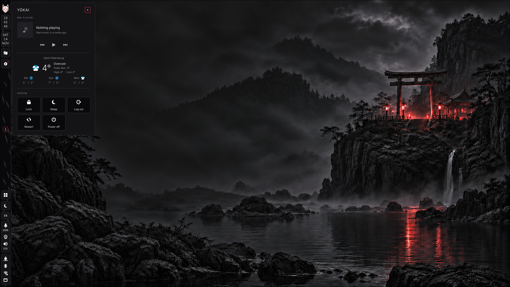
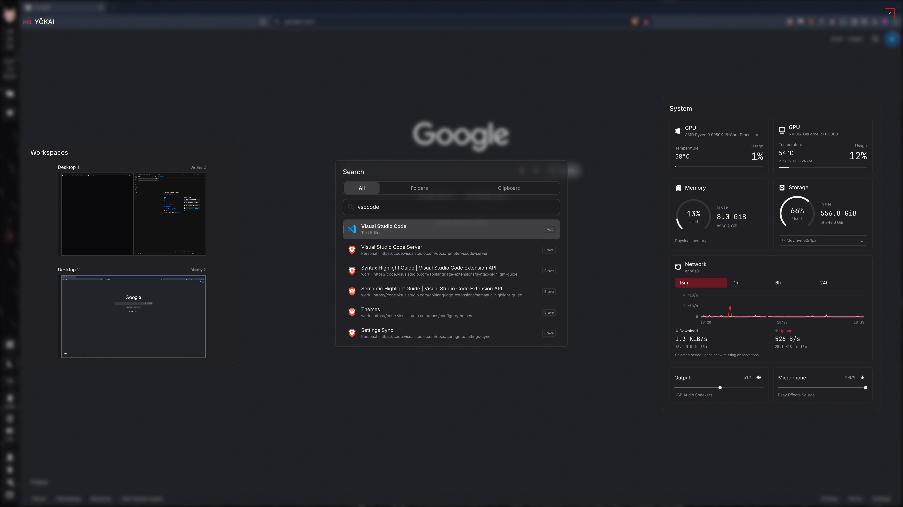
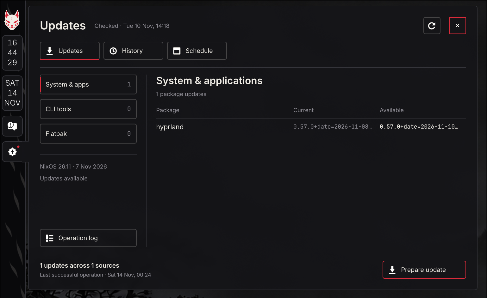
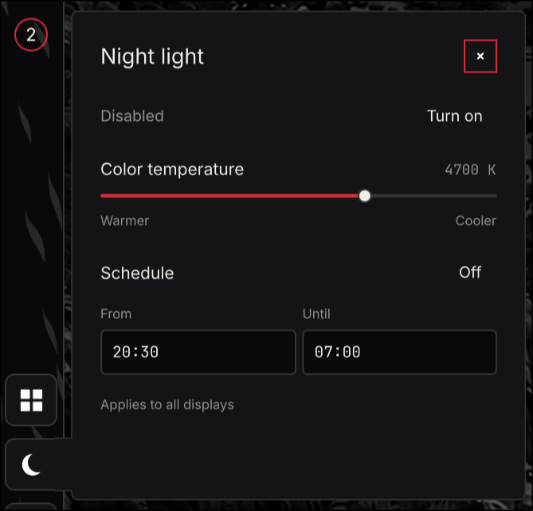
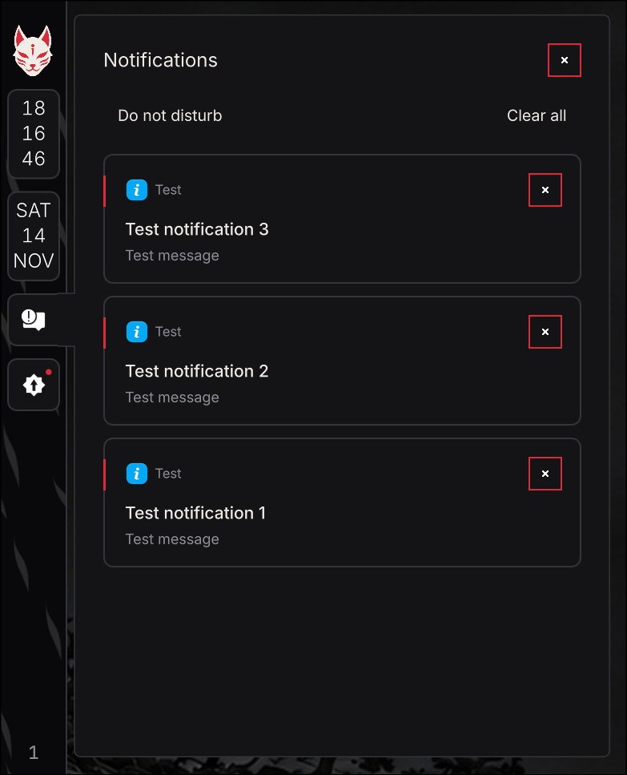

# YŌKAI NixOS

An x86_64-linux desktop with Hyprland, the YŌKAI Quickshell shell, Home Manager,
Zsh and Ghostty. It includes desktop applications, development tools and Steam.
Application selection is grouped in `apps.nix`. Hardware, identity, VPN,
physical displays and personal services belong in the consuming host.

## Features

- Modular NixOS and Home Manager configuration, with hardware and personal settings supplied by the host.
- Hyprland desktop with workspace previews, window switching and keyboard/mouse controls.
- YŌKAI Quickshell panel with application search, clipboard history, notifications, audio, networking and Bluetooth controls.
- Brave history search with normalized URLs, plus optional Telegram chat/contact search.
- Matching terminal, shell prompt, file manager, login and session-lock themes.
- A shared wallpaper collection with hourly rotation across the desktop, lock screen and SDDM.
- Region/full-screen screenshots, annotation, color picking and screen recording.
- Optional update panel and scheduled system, CLI and Flatpak maintenance.
- Daily garbage collection and automatic Nix store deduplication.

## Build the example

```sh
nix eval --raw .#nixosConfigurations.example.config.system.build.toplevel.drvPath --no-write-lock-file
nix flake check --no-build --no-write-lock-file
nix build .#checks.x86_64-linux.scripts --no-link --no-write-lock-file
nix build .#nixosConfigurations.example.config.system.build.toplevel
```

The example uses user `demo`, automatic output placement and placeholder disk
labels. Supply your own hardware, boot, filesystem and account configuration
before installing. Preserve an existing installation's stateVersion values.

## Use the modules

Add this repository to a host flake using a GitHub URL or an absolute `path:` input:

```nix
{
  inputs.desktop.url = "github:null-enjoyer/yokai-nixos-config";
  inputs.nixpkgs.follows = "desktop/nixpkgs";
  outputs = { desktop, nixpkgs, ... }: {
    nixosConfigurations.workstation = nixpkgs.lib.nixosSystem {
      system = "x86_64-linux";
      modules = [
        desktop.nixosModules.desktop
        ./hardware-configuration.nix
        ./host.nix
        {
          nixpkgs.config.allowUnfree = true;
          home-manager.useGlobalPkgs = true;
          home-manager.useUserPackages = true;
          home-manager.users.demo = {
            imports = [ desktop.homeManagerModules.desktop ];
            home.username = "demo";
            home.homeDirectory = "/home/demo";
            home.stateVersion = "26.05";
          };
        }
      ];
    };
  };
}
```

`host.nix` defines users, hostname, boot settings and system.stateVersion.
The desktop export includes Hyprland, Home Manager and the package overlay.
`useGlobalPkgs` shares that package set with Home Manager.

## Configuration

- `apps.nix`: system/user package lists and application enables, grouped by purpose.
- `modules/nixos/`, `modules/home/`: detailed system and user settings.
- `config/yokai/Theme.qml`, `config/ghostty/config`: desktop and terminal colors.
- `wallpapers/`: desktop, lock-screen and SDDM backgrounds.
- `overlays/`, `pkgs/`: package pins and patches.
- `tests/`: integration checks.

Docker is enabled. The host supplies container group membership. Flatpak/Flathub
is included, with Brave installed by `flatpak-install-apps.service` after activation.
Select Flathub applications with `desktop.flatpak.packages`. Removal is manual,
and their versions are independent of `flake.lock`. If installation fails, restore
connectivity and run `sudo systemctl restart flatpak-install-apps`.

Separate exports: `nixosModules.flatpak`, `nixosModules.updates` and
`overlays.default`. The `default` module exports alias `desktop`.
See the [YŌKAI guide](config/yokai/README.md) for integrations and development.

## Screenshots

### Desktop menu

Media, weather and session controls.



### Control panel

Application search, workspace previews and system metrics.



### Updates

System, CLI and Flatpak update controls.



### Night light

Color temperature and scheduling.



### Notifications

Notification history and do-not-disturb mode.



## Wallpapers

Add PNG, JPEG or WebP images to `wallpapers/` and rebuild. Stage new files with
Git so the flake includes them. One image stays fixed. Multiple images cycle in
filename order at hourly boundaries. Desktop, lock screen and SDDM share the
selection. An empty folder gives a plain dark background.
For a live `YOKAI_CONFIG` checkout, the sibling repository's `wallpapers/` is used.
`YOKAI_WALLPAPERS` can select another directory for the shell and lock screen.

## Keyboard shortcuts

`Super` is the Windows/Meta key. These tables list bindings configured by this
repository. Applications retain their other upstream defaults. Host-only bindings
are defined separately.

### Desktop and windows

| Shortcut | Action |
|---|---|
| Super+Enter | Open Ghostty |
| Ctrl+Alt+Space | Show/hide a terminal on the current workspace |
| Super+Space | Open YŌKAI search |
| Super+V | Open clipboard history |
| Super+L | Lock the session |
| Super+Q | Close the focused window |
| Super+E | Open superfile in Ghostty |
| Super+A | Open audio settings |
| Super+Esc | Open the session/power menu |
| Super+F | Toggle fullscreen |
| Super+J | Toggle split orientation |
| Super+Arrow | Focus a window in that direction |
| Super+Shift+Arrow | Move a window in that direction |
| Super+Ctrl+Arrow | Resize a window by 40 pixels |
| Super+1–9 / Super+0 | Focus workspace 1–9 / 10 |
| Super+Shift+1–9 / Super+Shift+0 | Move a window to workspace 1–9 / 10 |
| Super+S | Toggle the magic workspace |
| Super+Shift+S | Move a window to the magic workspace |
| Alt+Tab / Alt+Shift+Tab | Select the next/previous window |
| Release Alt / Enter in window switcher | Activate the selected window |
| Arrows in window switcher | Select the nearest window in that direction |
| Super+left drag | Move a window and finish tiled |
| Super+Shift+left drag | Move a window and keep it floating |
| Super+right drag | Resize a window |
| Super+G | Toggle shortcut passthrough |
| Caps Lock | Switch US/RU keyboard layout |
| Compose | Additional Meta modifier |

### Capture and media

| Shortcut | Action |
|---|---|
| Print | Copy a selected screen region |
| Super+Print | Capture and annotate a region in Satty |
| Shift+Print | Copy the full desktop |
| Super+Shift+C | Pick a color and copy it |
| Super+Shift+R | Start/stop a region recording with wf-recorder |
| Volume up/down | Change volume by 5% |
| Mute | Toggle audio mute |
| Brightness up/down | Change brightness by 5% |
| Media play/pause | Toggle playback |
| Media next/previous | Skip to the next/previous track |

### YŌKAI and session menu

| Context | Shortcut | Action |
|---|---|---|
| Search/clipboard | Tab / Shift+Tab | Cycle All, Folders and Clipboard |
| Search/clipboard | Up / Down | Select a result |
| Search | Enter | Open the selected result |
| Clipboard | Enter | Paste the selected entry into the previous window |
| Clipboard | Ctrl+Delete | Delete the selected entry |
| Panels/search | Esc | Close the panel or search |
| Screen selection | Esc | Cancel capture |
| Lock screen | Enter / Esc | Submit password / clear input |
| Session menu | L / H / E | Lock / hibernate / log out |
| Session menu | S / U / R | Shut down / suspend / reboot |

### Terminal and shell

| Context | Shortcut | Action |
|---|---|---|
| Ghostty | Ctrl+Shift+W | Close the current surface |
| Ghostty | Ctrl+Shift+Left / Right | Navigate splits, falling back to adjacent tabs |
| Ghostty | Ctrl+Enter, Ctrl+Alt+Left / Right | Unbound |
| Zsh | Ctrl+R | Search history with Atuin |
| Zsh | Ctrl+O | Open broot |
| Zsh, empty command line | Tab | Open broot |
| Zsh, nonempty command line | Tab | Complete the current command |
| Zsh | Ctrl+Right | Move forward one word |

### Neovim

`Leader` is Space. Completion bindings apply in Insert mode. The others use Normal mode.

| Shortcut | Action |
|---|---|
| Leader ff / fg | Find files / search file contents |
| Leader fb / fh | Find buffers / help tags |
| Leader e | Toggle the file tree |
| gd / gr | Go to definition / find references |
| K | Show hover documentation |
| Leader rn / ca | Rename symbol / show code actions |
| Leader tm | Toggle rendered Markdown |
| Ctrl+H/J/K/L | Focus the adjacent split |
| Esc | Clear search highlighting |
| Ctrl+Space | Show completion |
| Ctrl+Y | Accept completion |
| Tab / Shift+Tab | Select next/previous completion |

## Update

```sh
nix flake update
```

Daily GC retains ten days of generations. Identical store files are deduplicated
automatically. Override these defaults through `nix.gc` and
`nix.settings.auto-optimise-store`.

The optional update panel requires host integration. Enable scheduled jobs with
`desktop.updates.automatic.enable`. `systemCalendar`, `toolsCalendar` and
`flatpakCalendar` customize their times. CLI updates additionally require a host
`toolsPackage` providing `update-tools`.
CI evaluates the example and runs script checks without building the full system.
